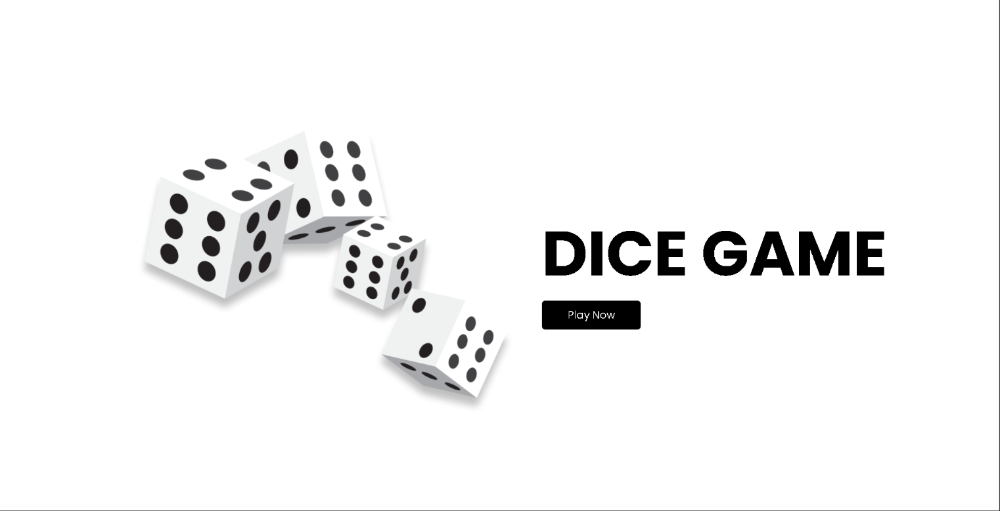
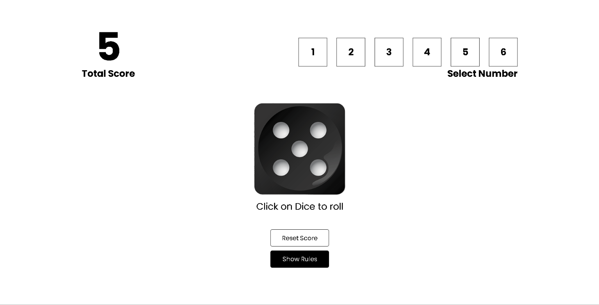
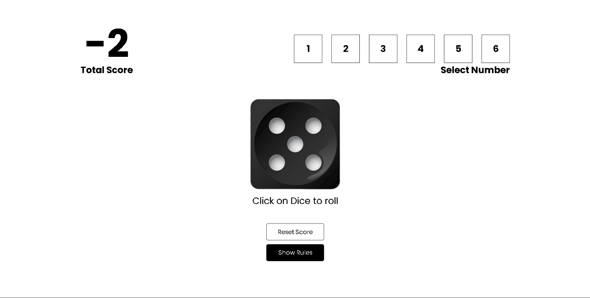
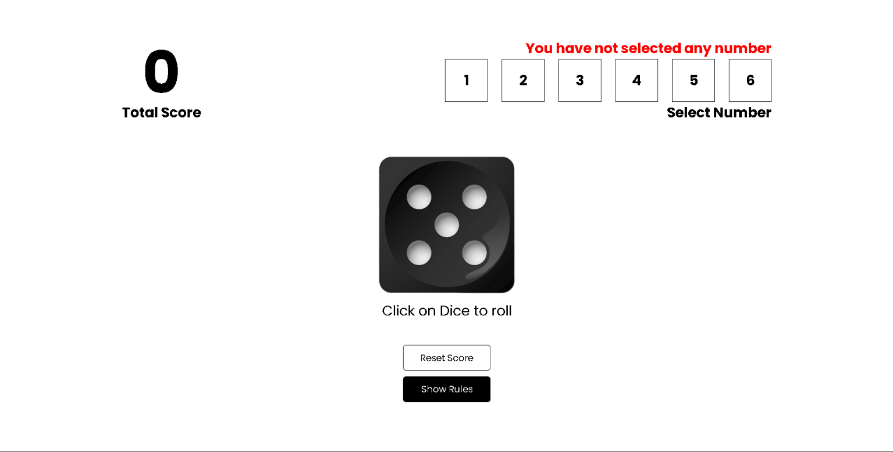
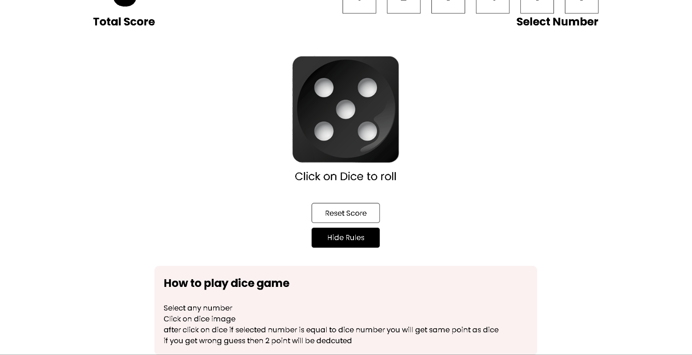
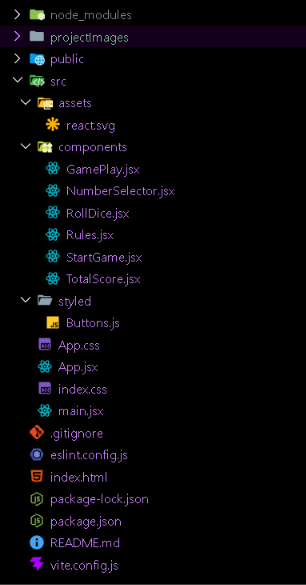

#  Dice Game

A simple and fun number-guessing dice game built with **React** and **styled-components**. Select a number, roll the dice, and test your luck — guess correctly to earn points equal to the dice roll, or lose points for a wrong guess!

##  Live Preview

**Landing Screen**



**Gameplay**



**Wrong Guess (Points Deducted)**



**No Number Selected Warning**



**Rules Panel**



##  How to Play

1. Select any number (1–6) from the **Select Number** panel.
2. Click on the dice image to roll it.
3. If the number you selected matches the number rolled, you earn points equal to the dice value.
4. If your guess is wrong, **2 points** are deducted from your total score.
5. If no number is selected before rolling, the game will alert you: *"You have not selected any number."*
6. Use **Reset Score** to start over, and **Show Rules / Hide Rules** to toggle the instructions panel.

##  Features

-  Interactive number selection (1–6)
-  Click-to-roll animated dice
-  Real-time score tracking (increases or decreases based on your guess)
-  Validation when no number is selected
-  Toggleable in-game rules panel
-  Reset score functionality
-  Styled entirely with `styled-components`

##  Tech Stack

| Technology | Purpose |
|---|---|
| [React 19](https://react.dev/) | UI library |
| [Vite](https://vite.dev/) (rolldown-vite) | Build tool & dev server |
| [styled-components](https://styled-components.com/) | Component-level styling |
| [ESLint](https://eslint.org/) | Code linting |

##  Project Structure

```
project-3/
├── public/
├── src/
│   ├── assets/
│   │   └── react.svg
│   ├── components/
│   │   ├── GamePlay.jsx
│   │   ├── NumberSelector.jsx
│   │   ├── RollDice.jsx
│   │   ├── Rules.jsx
│   │   ├── StartGame.jsx
│   │   └── TotalScore.jsx
│   ├── styled/
│   │   └── Buttons.js
│   ├── App.css
│   ├── App.jsx
│   ├── index.css
│   └── main.jsx
├── .gitignore
├── eslint.config.js
├── index.html
├── package.json
├── package-lock.json
└── vite.config.js
```

### Component Overview

- **`StartGame.jsx`** – Landing screen with the game title and "Play Now" button.
- **`GamePlay.jsx`** – Main game screen that composes the score, number selector, dice, and rules.
- **`NumberSelector.jsx`** – Renders the 1–6 number selection buttons.
- **`RollDice.jsx`** – Displays the dice and handles the roll interaction.
- **`TotalScore.jsx`** – Displays and updates the running total score.
- **`Rules.jsx`** – Shows/hides the "How to Play" instructions panel.
- **`styled/Buttons.js`** – Shared styled-component button styles used across the app.

##  Getting Started

### Prerequisites

- [Node.js](https://nodejs.org/) (LTS recommended)
- npm

### Installation

```bash
git clone https://github.com/<your-username>/project-3.git
cd project-3
npm install
```

### Run the development server

```bash
npm run dev
```

The app will be available at `http://localhost:5173/` (or the next available port).

### Build for production

```bash
npm run build
```

### Preview the production build

```bash
npm run preview
```

### Lint the project

```bash
npm run lint
```

##  Dependencies

**Runtime**
- `react` ^19.2.0
- `react-dom` ^19.2.0
- `styled-components` ^6.1.19

**Dev**
- `vite` (rolldown-vite ^7.2.5)
- `@vitejs/plugin-react` ^5.1.1
- `eslint` ^9.39.1 with `eslint-plugin-react-hooks` and `eslint-plugin-react-refresh`
- `@types/react`, `@types/react-dom`
- `globals`

##  Project Structure Screenshot



##  License

This project is open source and available for personal or educational use.

##  Author

Made with  by  ** Melan Parajuli **
